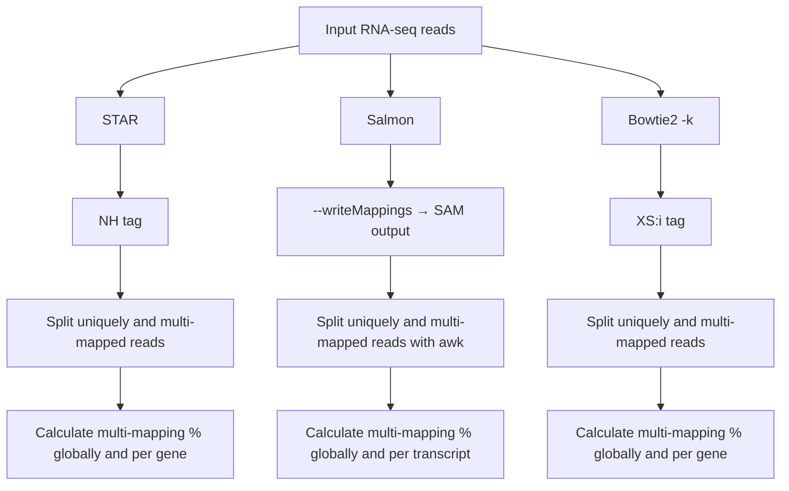

# Estimating multi-mapping rates

[← Back to README](README.md)

The amount of multi-mapping in a dataset depends on the repetitiveness of the genome, the read length and the quality of the annotation. Below we describe how to estimate it with three widely used tools.

---

## STAR

- Multi-mapping reads were detected with the `NH` tag, which STAR adds to every alignment to report the number of loci the read maps to.
- Reads with `NH:i:1` were classified as uniquely mapped, and reads with `NH:i` > 1 as multi-mapped.
- The percentage of multi-mapped reads was calculated as the proportion of multi-mapped reads over the total number of mapped reads, both globally and per gene.

This is automated in the script **`Multi-mapping:STAR.sh`**, which runs **STAR**, **samtools** and **featureCounts** and reports the percentage of multi-mapped reads per gene.

<sub>**Requires** [STAR](https://github.com/alexdobin/STAR), [samtools](http://www.htslib.org/) and [featureCounts (Subread)](https://subread.sourceforge.net/) in your `$PATH`. Make the script executable first with `chmod +x Multi-mapping:STAR.sh`.</sub>

```bash
./Multi-mapping:STAR.sh -g <GENOME_INDEX> -a <ANNOTATION> -1 <READS_1.fastq> -2 <READS_2.fastq> -o <OUTPUT_DIR> [-t THREADS]
```

| Flag | Description |
|------|-------------|
| `-g` | STAR genome index directory |
| `-a` | Annotation file (GTF/GFF) |
| `-1` | Reads 1 FASTQ file |
| `-2` | Reads 2 FASTQ file |
| `-o` | Output directory |
| `-t` | Threads *(optional, default = 8)* |
| `-h` | Show help message |

---

## Salmon

To obtain transcript-level counts from Salmon, the `--writeMappings` parameter was used to generate a SAM file containing all alignments. From this file, uniquely mapped and multi-mapped reads were separated, and transcript counts were calculated as follows.

**1. Extract read IDs**
```bash
awk '!/^@/ {count[$1]++} END {for (id in count) if (count[id] == 1) print id}' ${SAMPLE_OUT}_all_mappings.sam > ${SAMPLE_OUT}_unique_ids.txt
awk '!/^@/ {count[$1]++} END {for (id in count) if (count[id] > 1) print id}' ${SAMPLE_OUT}_all_mappings.sam > ${SAMPLE_OUT}_multi_ids.txt
```

**2. Create SAM files**
```bash
grep -Ff ${SAMPLE_OUT}_unique_ids.txt ${SAMPLE_OUT}_all_mappings.sam > ${SAMPLE_OUT}_unique.sam
grep -Ff ${SAMPLE_OUT}_multi_ids.txt ${SAMPLE_OUT}_all_mappings.sam > ${SAMPLE_OUT}_multi.sam
```

**3. Count transcripts** (unmapped records are excluded)
```bash
awk -F'\t' '$3 != "*" {count[$3]++} END {for (t in count) print t, count[t]}' ${SAMPLE_OUT}_unique.sam > ${SAMPLE_OUT}_unique_counts.txt
awk -F'\t' '$3 != "*" {count[$3]++} END {for (t in count) print t, count[t]}' ${SAMPLE_OUT}_multi.sam > ${SAMPLE_OUT}_multi_counts.txt
```

**4. Sort counts**
```bash
sort ${SAMPLE_OUT}_unique_counts.txt > ${SAMPLE_OUT}_unique_sorted.txt
sort ${SAMPLE_OUT}_multi_counts.txt > ${SAMPLE_OUT}_multi_sorted.txt
```

**5. Calculate the percentage of multi-mapping reads per transcript**

The unique and multi-mapping transcript counts were merged with `join`. For each transcript, the percentage of multi-mapping reads relative to the total (unique + multi) was calculated with `awk`, and the results were saved to a CSV file.

---

## Bowtie2

Although Bowtie2 is not the most recommended option for highly repetitive genomes, it can still be used to track multi-mapping reads. To do so, the `-k` parameter must be enabled so that Bowtie2 reports multiple valid alignments per read; otherwise only one alignment per read is reported and multi-mapping is underestimated.

Multi-mapping reads were identified with the `XS:i` tag (present when a read has an alternative valid alignment).

**Extract multi-mapping reads**
```bash
samtools view -h sample_sorted.bam \
| awk '$0 ~ /^@/ || $0 ~ /XS:i:[0-9]+/' \
| samtools view -Sb - \
> multimapping_reads.bam
```

**Extract unique reads**
```bash
samtools view -h sample_sorted.bam \
| awk '$0 ~ /^@/ || ($0 !~ /XS:i:[0-9]+/ && $1 !~ /^@/)' \
| samtools view -Sb - \
> unimapping_reads.bam
```

Reads in each BAM file were then counted per gene with featureCounts, and the percentage of multi-mapping reads was calculated globally and per gene, as for STAR.
<!-- TODO: confirm this description matches what was actually done. -->

---

## Summary


